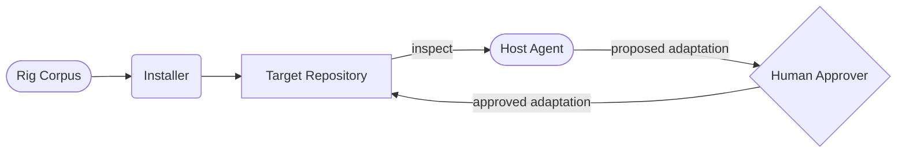
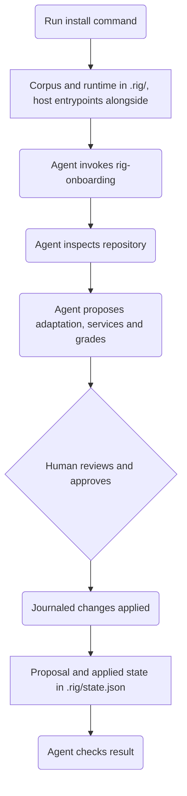
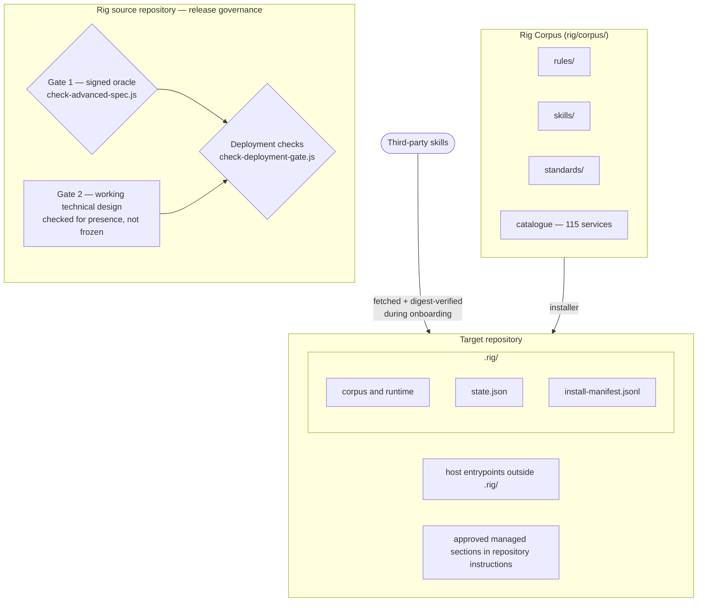

# Architecture

This page shows how Rig is structured through three diagram views, from the highest-level overview down to the internal file layout. For per-host entrypoint and MCP configuration details, see [agent-portability.md](agent-portability.md).

---

## View 1 — What Rig connects

Rig projects a central library into repositories. The repository's agent proposes an adaptation, including services and grades; a human approves that exact proposal before it is applied.

---

## View 2 — How installation works

Installation adds the corpus, runtime, and host entrypoints first. The agent then proposes services, grades, and repository changes; only the approved adaptation is applied.

---

## View 3 — What lives where

The target repository contains `.rig/` plus host entrypoints and managed sections outside it. Rig's source-release checks are separate: the signed acceptance oracle is Gate 1, Gate 2 is the working technical design checked for presence, and deployment checks govern Rig releases. These release scripts and workflows are not installed into the target.

The installed baseline records the repository owner's sign-off selection.
Cryptographic approvals use Rig's existing trust root. Acknowledgement is
unsigned and labeled as such. Platform mode has no verified adapter yet, so it
refuses approvals. Public release evidence checks current security and review
readiness for every sign-off mode.

Third-party skills are fetched from pinned upstream sources and digest-verified during approved onboarding. Service selection belongs to that proposal and its recorded state; `rig.json` remains a legacy configurator path.

---

## Reference

- [Installation guide](install.md) — step-by-step setup
- [Host portability details](agent-portability.md) — per-host entrypoints and MCP config
