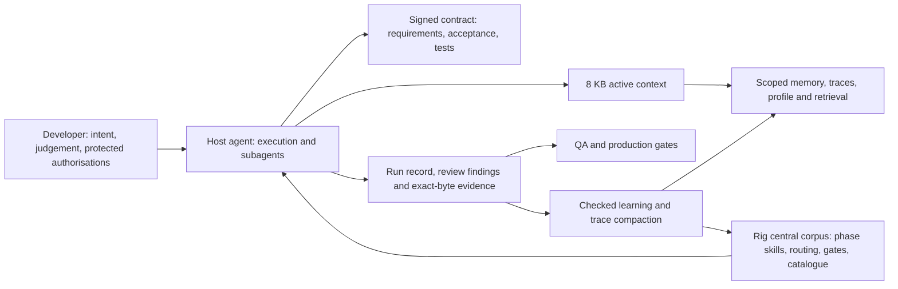

# Executive architecture summary

The owner's [final-definition directive](../../reasoning/2026-10-24-final-product-definition-owner-directive.md)
adds the permanent atomic requirement-to-acceptance rule. The detailed
[approval candidate](15-gate1-contract.md), [test obligations](16-test-manifest.md),
[lifecycle](17-customer-lifecycle.md), [interaction diagrams](18-system-interactions.md),
[public-product roadmap](19-work-packages-and-public-roadmap.md) and
[traceability audit](20-traceability-audit.md) are the current planning package.
It is ready for product review; new-programme test files and manifest selection
must exist before it can be signed with the owner's existing key.

**Proposed product; no new implementation is authorised.** Rig is the
engineering discipline around a developer's host agent. The developer supplies
the idea, missing intent, product judgements and protected authorisations. The
host agent performs the engineering. Rig supplies one portable workflow,
reusable skills, deterministic gates, bounded context, review and delivery
evidence, and a safe way to learn from repeated work.

The product must carry a change **from installation to verified delivery**. A
memory ledger helps that journey; it is one component of the product, not the
product definition. The [owner's latest directive](../../reasoning/2026-10-23-ai-sdlc-product-first-owner-directive.md)
approves this product-first scope and settles the prior decision list.

## The customer journey

| Stage | What the developer experiences | What Rig makes the agent do |
|---|---|---|
| Install and onboard | Point an agent at a repository; review consequential grafts | Discover existing tools and skills, offer one useful capability per gap, import a profile if supplied |
| Discover and specify | State the idea; answer only material questions | Preserve original intent, resolve contradictions, write requirements and observable acceptance criteria |
| Lock | Review the contract and use the one human key | Sign requirements, acceptance and manifested tests together before technical design |
| Design and plan | See a concise recommended approach | Inspect code and pinned upstream candidates, choose one owner per capability, scope verifiable work |
| Build | Receive progress and decisions, not project administration | Route bounded tasks to the least expensive reliable mechanism; coordinate edits and preserve unrelated work |
| Verify | See defects, evidence and remaining blockers | Run tests, independent review, carried findings and bounded infrastructure retries against exact bytes |
| Deliver | Authorise protected delivery actions | Prepare clean artefacts and exact-candidate evidence; follow the established QA/production gates |
| Learn | Need to repeat fewer instructions next time | Retain useful preferences, propose skills/checks, compact traces safely, export portable profile |

The [lifecycle](04-lifecycle.md) specifies ordinary and failure paths for each
stage, including an unavailable reviewer, session reset, concurrent agents and
a move to a new project.

## Architectural boundaries

- **One central corpus, agent-led adaptation.** Rig projects known host
  entrypoints; the host agent chooses the smallest useful graft after inspecting
  the repository. Rig does not own a model loop or model key.
- **One protected contract.** Requirements and acceptance criteria lock
  together under the existing Gate 1 key. Technical design is presence-checked
  and editable; routine memory or documentation updates do not re-sign it.
- **Memory has levels.** The approved 8 KB cap applies to the always-read active
  view. Developer and project memory, evidence and historical traces live in
  separate stores with provenance, selective retrieval and explicit retention.
  The public release ships offline meaning-based search by default. Memory is
  mutable data, never permission or a replacement for the signature.
- **Routing is a product capability.** Deterministic tools handle mechanical
  work; available host models are classified by capability, cost and risk.
  Weak or missing evidence escalates to a stronger model or a human decision.
  Children cannot certify their own protected work or edit the signed oracle.
- **Learning is controlled.** A repeated instruction triggers a candidate
  persistent mechanism; a repeated defect triggers a prevention proposal.
  Safe memory maintenance may be automatic. Executable or security-sensitive
  promotion follows the existing authority boundary and independent regression
  evidence.

## Open-source inheritance

The [source-level matrix](12-reuse-plan.md) pins upstream commits and separates
actual source reuse from an independently implemented idea. The planned
inheritance is selective: Superpowers' compatible skill material is folded into
existing Rig phase owners; Claude-Mem's context-budget algorithm and Hermes'
memory-context fencing are candidates for narrow ports; Deep Agents supplies
host-adapter and context-isolation contracts; Harness² contributes an
evaluation pattern only after its unsafe assumptions are removed. Existing
Rig review, signing, onboarding and release mechanisms remain authoritative.
Licences, notices, discarded dependencies and verification are named per row.

## Build order and honest maturity

The first vertical slice is **one change from idea through signed acceptance,
scoped implementation, review and a delivery-ready evidence report** in a fresh
repository. It uses existing Rig gates and adds only the missing phase handoffs,
a minimal run record and recovery needed to make that journey work. Later slices
add the 8 KB active view, richer retrieval, adaptive model routing, portable
profiles, trace retention and controlled learning. The [public-product roadmap](19-work-packages-and-public-roadmap.md) gives each package
an observable exit condition and dependency.

Today the central corpus, adaptive onboarding, signed oracle, review wrapper
and deployment checks exist. The review-state-machine change is locally green
and uncommitted. The active memory view, full lifecycle orchestration, model
routing, offline semantic retrieval, profile transfer and automatic trace retention are
**proposed**. A local green gate does not certify the 6.0.0 release or this
future product. The [preservation report](10-current-state.md) keeps those
tracks separate.
