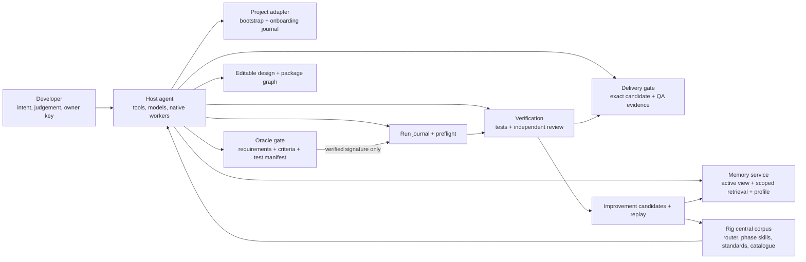
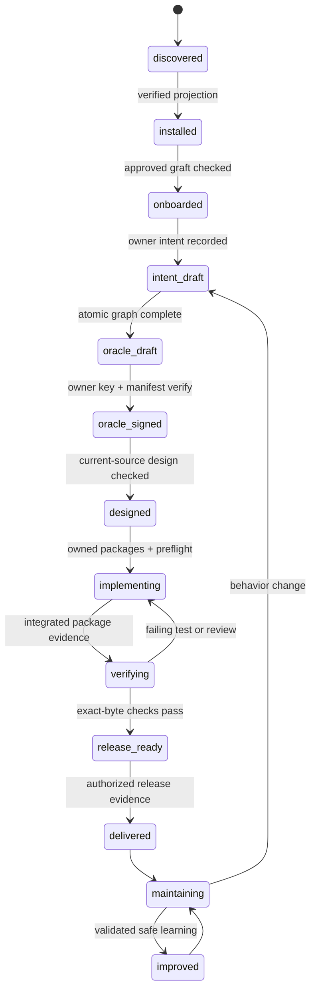
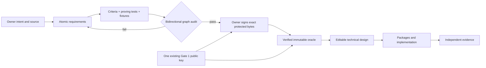
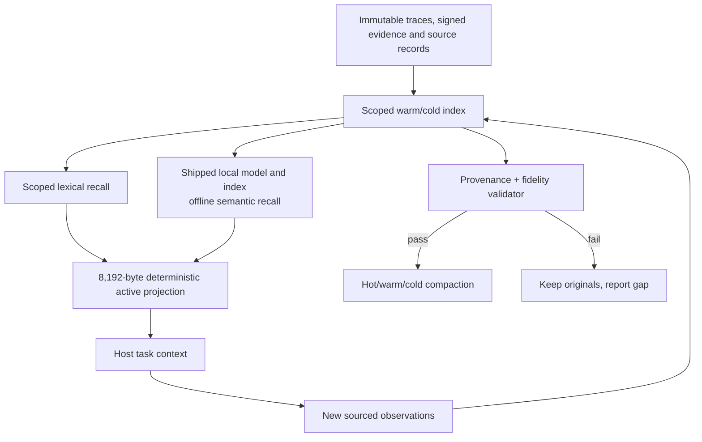
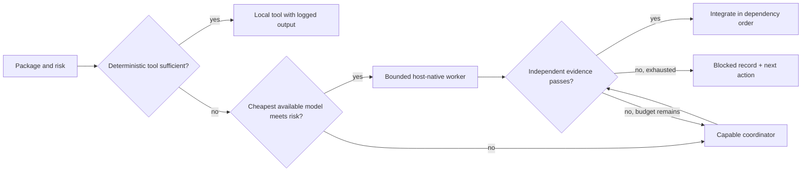
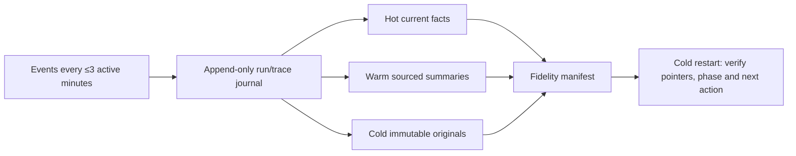
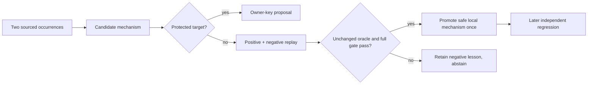
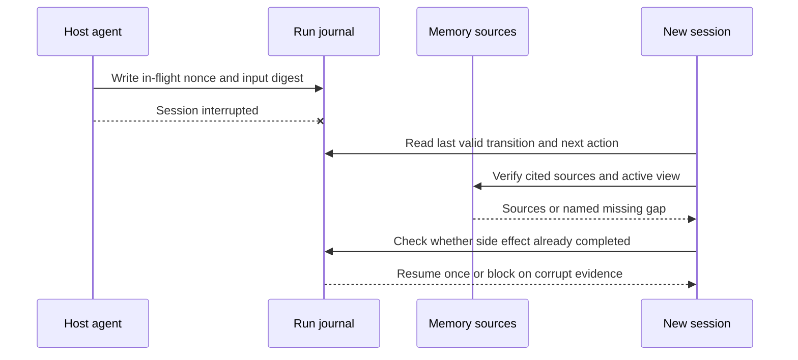

# Implementable system interactions

This supplements the [component contracts](02-architecture.md). It is an
editable technical design and is **outside** the proposed signed oracle. Each
component has one owner. Paths are illustrative seams to validate against
current code in the first implementation package; the signed acceptance is
about behavior, not these names.

## Components, authority and data



The host agent executes all engineering steps. Rig supplies the single corpus,
deterministic validation, durable state and phase instructions. It does not own
a second model loop. The developer alone supplies protected authorization. A
worker or memory record never becomes authority by making a persuasive claim.

| Interface | Writer → reader | Persisted form and invariant | Failure behavior |
|---|---|---|---|
| Contract graph | grilling → signer, design, coordinator, auditor | Atomic requirement, primary criterion, test and fixture IDs; owner source; immutable after signature | Missing/duplicate/orphan edge blocks signing and package execution. |
| Oracle proof | owner key → preflight and release | One SSH signature over exact business, acceptance and test-manifest bytes; existing trust root | Absent/invalid key keeps protected transition closed. |
| Design and work graph | product-design → coordinator | Editable design digest; packages with disjoint file ownership and dependencies | Revision revalidates mapping and invalidates downstream receipts for changed candidate bytes. |
| Run journal | phase owner → cold-session host agent | Atomic transition record: run ID, phase, input digest, owner, nonce, budget, output digest, evidence pointers, next action | Torn/incomplete write is interrupted; replay checks idempotency before retry. |
| Memory | host agent → projection/retrieval | Scoped source records, provenance, supersession, 8,192-byte active projection and citations | Corrupt projection rebuilds; missing source becomes a named gap. |
| Worker brief | coordinator → host-native worker | Package ID, exact acceptance slice, allowed files, source citations, budget and stop rule; private fields excluded | No host worker means sequential host execution or named capability gap. |
| Evidence | tools/reviewer → coordinator/release | Command, exit/result, candidate digest, timestamp, independent verdict and normalized findings | No structured positive evidence means incomplete, not passed. |
| Improvement candidate | occurrence detector → replay gate | Two sources, classification, proposed smallest mechanism, baseline and negative cases | Protected target routes to owner; no-effect/regression persists as rejected candidate. |

## Lifecycle state and signing boundary



Every transition can enter `blocked` or `interrupted` and retains the preceding
valid state. Resume checks the journal and digests, then returns to the
incomplete transition. A changed requirement goes through an owner amendment;
an editable design revision does not silently rewrite the signed oracle.



The programme needs a **separate manifested contract under the existing key**.
The current signer binds the existing release oracle, so implementation must
extend manifest selection with owner-reviewed exact bytes. It must not create
another signer, overwrite the old signed package, or sign this draft now.

## Memory, cost, concurrency and recovery



The always-read projection is UTF-8 byte measured. Retrieval has a separate
per-task budget and returns source IDs. Developer records can move between
projects; project decisions, oracle, secrets, run state and signer rights
cannot. Imported text remains untrusted. Repeated instructions may become a
skill candidate, but a memory item cannot grant permission.



The coordinator computes a dependency graph and reserves file ownership before
writer dispatch. Disjoint workers may run in isolated worktrees; shared files
have one integration owner. The child brief is an allowlist, not a full
conversation clone. Model availability and price are host observations; unknown
cost stays unknown. Limits on calls, retries, context and spend are recorded
before dispatch. A sequential run is preferred when coordination costs exceed
the bounded task.



Compaction may remove redundant *projection* text only after source-map and
representative cold-lookup checks pass. It cannot rewrite historical trace
bodies or remove sole protected evidence. The three-minute live cadence is
unchanged. Runtime traces are local data; no model call is needed to timestamp,
index, hash or move them.



Review findings feed this loop through the existing normalized finding key.
An independent reviewer supplies a verdict; the receipt verifies completion
and exact candidate bytes. Release checks consume the receipt, full test
evidence, automated QA health and real-download clean-install evidence on the
same commit. Protected evaluation, signing, policy, security and release rules
are outside the automatic improvement write set.

## Critical interaction sequences

```mermaid
sequenceDiagram
  actor Owner
  participant Host as Host agent
  participant Audit as Graph audit
  participant Key as Existing owner key
  participant Gate as Oracle verifier
  Owner->>Host: Describe product outcome
  Host->>Host: Recall settled sources; draft atomic requirements
  Host->>Owner: One material unresolved choice, if any
  Owner->>Host: Decide
  Host->>Audit: Requirements + criteria + manifested tests
  Audit-->>Host: Complete bidirectional graph or exact gaps
  Host->>Owner: Show exact protected bytes and behavior
  Owner->>Key: Approve/sign once
  Key-->>Gate: SSH signature over exact manifest
  Gate-->>Host: Verified oracle digest
  Host->>Host: Begin editable technical design
```

```mermaid
sequenceDiagram
  participant C as Coordinator
  participant P as Package graph
  participant W1 as Host worker A
  participant W2 as Host worker B
  participant V as Independent verifier
  C->>P: Validate oracle links, dependencies and file ownership
  P-->>C: Disjoint runnable packages
  par Independent work
    C->>W1: Scope A + acceptance + sources + budget
    C->>W2: Scope B + acceptance + sources + budget
  end
  W1-->>C: Diff + test evidence
  W2-->>C: Diff + test evidence
  C->>V: Verify both against unchanged oracle
  V-->>C: Pass/fail with candidate digests
  C->>C: Integrate in dependency order; rerun full gate
```



```mermaid
sequenceDiagram
  participant C as Coordinator
  participant R as Independent reviewer
  participant A as Review attempt ledger
  participant V as Verification
  C->>R: Exact diff + carried findings
  R--xA: Timeout or malformed output
  A-->>C: Pending; authorization unconsumed
  C->>R: Bounded retry with prior context
  R-->>A: Complete failing verdict + finding IDs
  A-->>C: Count completed attempt; persist findings
  C->>V: Fix common cause and rerun checks
  V-->>C: New exact-byte evidence
  C->>R: New diff + unresolved findings
```

```mermaid
sequenceDiagram
  participant O as Occurrence index
  participant H as Host agent
  participant E as Independent evaluator
  participant K as Owner key
  O-->>H: Same class seen twice with sources
  H->>H: Draft smallest skill/check and failure fixture
  H->>E: Before/after, positive/negative replay, unchanged oracle
  E-->>H: Pass, fail or no effect
  alt Safe unprotected mechanism passes
    H->>H: Promote once; record provenance
  else Protected target
    H->>K: Prepare exact proposal for owner action
  else Failed or no effect
    H->>O: Preserve negative lesson and abstain
  end
```

```mermaid
sequenceDiagram
  actor Owner
  participant Old as Old project agent
  participant Bundle as Portable profile
  participant New as New project agent
  Owner->>Old: Export working preferences
  Old->>Bundle: Developer-scope values and source links only
  Bundle-->>New: Untrusted import data
  New->>New: Validate schema; compare local conventions
  New-->>Owner: Applied, conflicted, rejected report
  Owner->>New: Resolve material conflicts
  New->>New: Rebuild local active view; verify no old authority
```

## Constraints and design choices to revisit only with evidence

- Default runtime adds no provider account, network call, daemon or second skill catalogue.
- The public artifact includes pinned local model, tokenizer and runtime assets.
  A fresh supported install must return cited meaning-based results with the
  network denied and no first-run download. Lexical recall remains a cited
  failure fallback and does not satisfy this release gate. Verify asset
  integrity and rebuild an incompatible embedding index on upgrade.
- Use the current installer, gate, review receipt, wiki index and release checks
  as seams. A source port replaces a planned custom algorithm; it does not sit
  beside a duplicate one.
- The package and artifact schemas are deliberately minimal; implementation
  can revise field names after the signed behavior is preserved and a migration
  test proves compatibility.
